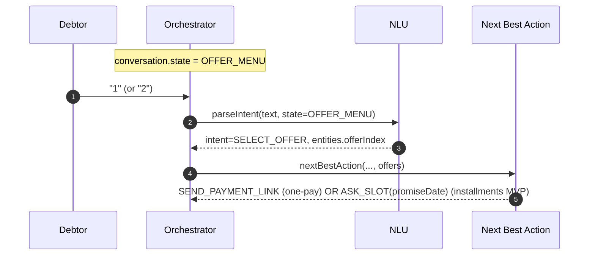

# Debtor Conversation Flows (MVP)

This document describes the debtor-facing automated conversation behavior (WhatsApp/Telegram), focusing on determinism + naturalness.

## Key ideas
- **Deterministic decisions**: Policy + Offer Engine + NBA decide what happens.
- **LLM usage**: NLU classification/extraction, plus optional rewrite of short drafts.
- **State-aware NLU**: The current conversation state is provided to NLU to reduce loops.

## NLU intents used in the flow (non-exhaustive)
- `GREETING`: greetings and `/start`
- `ASK_DETAIL`: ask for balance / details
- `NEGOTIATE`: ask for an agreement (discount / installments)
- `PAY_NOW`: wants to pay today / payment link
- `PROMISE_PAYMENT`: provides a date and/or amount to pay later
- `SELECT_OFFER`: selecting an offer when state is `OFFER_MENU` (uses `entities.offerIndex`)
- `ALREADY_PAID`: indicates payment already made
- `DISPUTE`: disputes debt / identity / fraud
- `ANGRY`: anger/escalation
- `OPT_OUT`: requests to stop contact
- `OFFTOPIC` / `UNKNOWN`: does not match the cobranzas context

## Main inbound flow
```mermaid
sequenceDiagram
  autonumber
  participant D as Debtor
  participant CH as Channel (WA/TG)
  participant ORCH as Orchestrator
  participant DM as Dialogue Manager (optional)
  participant NLU as NLU (LLM + deterministic)
  participant HF as Handoff Router
  participant OFF as Offer Engine
  participant NBA as Next Best Action
  participant W as Response Writer

  D->>CH: Send message
  CH->>ORCH: NormalizedInboundEvent (SQS)
  Note over ORCH: If DIALOGUE_MANAGER_ENABLED=true, try DM
  alt Dialogue Manager enabled and valid
    ORCH->>DM: decide(nlu+nba) with strict JSON schema
  else DM disabled or invalid
    ORCH->>NLU: parseIntent(text, conversationState)
  end
  ORCH->>HF: maybeHandoff(tenantPolicy, stage, intent)
  alt no handoff
    ORCH->>OFF: buildOffers(tenantPolicy, debtor, conversation)
    Note over ORCH: NBA + Writer can come from DM or deterministic engine
    ORCH->>NBA: nextBestAction(...) OR dm.nba
    ORCH->>W: writeResponse(...) OR dm.messageDraft
    ORCH-->>CH: Send reply
  else handoff
    ORCH-->>CH: Acknowledge + request verification details
  end
```

## Offer selection (in `OFFER_MENU`)


## Ops toggles
- `LLM_REWRITE_ENABLED=false`: disables the optional rewrite step and uses deterministic templates only.
- `DIALOGUE_MANAGER_ENABLED=true`: enables the Dialogue Manager path (falls back safely if invalid).

## Future upgrade (agent framework)
If we later adopt an agent framework (e.g. Voltagent-style), the recommended evolution is:
- Keep this repository's **policy / offer engine / audit / safety** as deterministic governors.
- Move DM into an agent runtime that plans tool calls, but still outputs **strict JSON** decisions.
- Treat `strategyPolicy` as the source of truth for objective/constraints per tenant.

For a more concrete migration path and tool catalog, see `docs/04-llm.md` (section: "Future upgrade: agent runtime (Voltagent-style)").

## Where in code
- NLU: `src/core/nlu/parseIntent.ts`
- NBA: `src/core/nba/nextBestAction.ts`
- Writer: `src/core/llm/responseWriter.ts`
- Orchestrator: `src/handlers/orchestrator.ts`
- Handoff: `src/core/handoff/handoff.ts`
